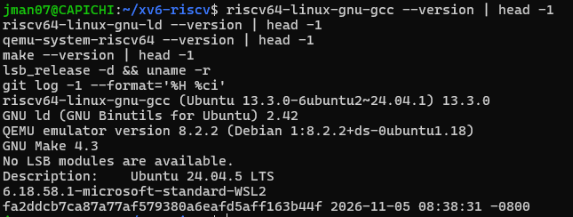
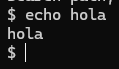
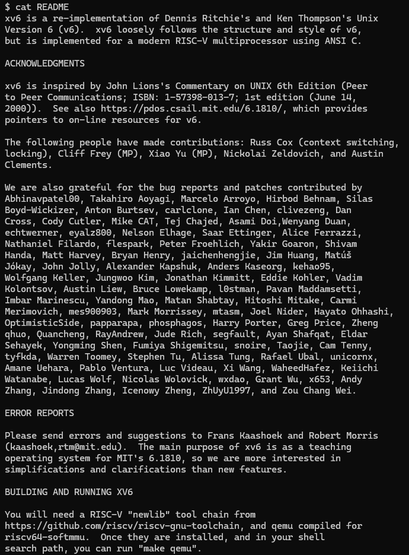
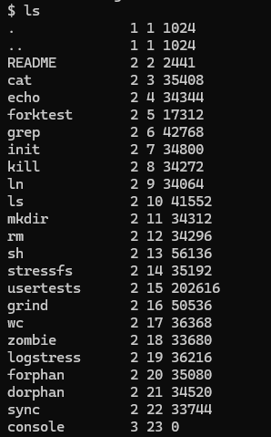
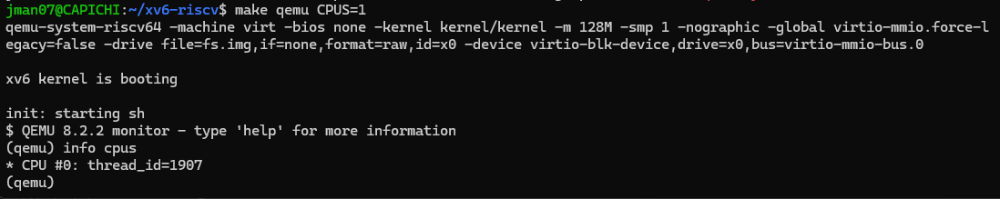
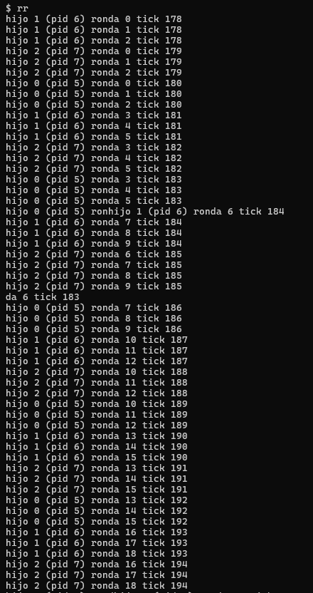
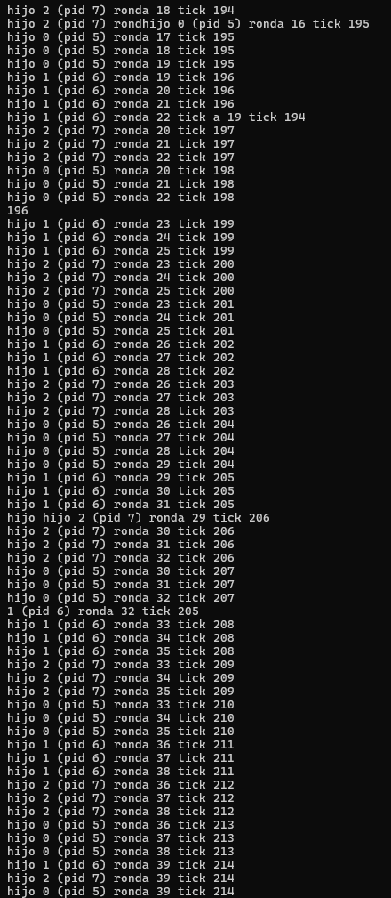

# Exploración de la planificación de procesos en XV6

**Curso:** Sistemas Operativos
**Integrantes:** Juan Manuel Rosero — Natalia Andrea Parra
**Repositorio (fork):** `https://github.com/nataliaandreaparra-arch/xv6-riscv`

---

## 1. Repositorio y entorno

### 1.1 Sistema operativo y commit de partida

- **Sistema operativo:** Ubuntu 24.04.5 LTS sobre WSL2 (kernel `6.18.58.1-microsoft-standard-WSL2`).
- **Commit de partida:** `fa2ddcb7ca87a77af579380a6eafd5aff163b44f` (2026-11-05 08:38:31 -0800), del repositorio oficial `mit-pdos/xv6-riscv`.

### 1.2 Herramientas y versiones

| Herramienta | Versión |
|---|---|
| `riscv64-linux-gnu-gcc` | 13.3.0 (Ubuntu 13.3.0-6ubuntu2~24.04.1) |
| GNU ld (binutils) | 2.42 |
| `qemu-system-riscv64` | 8.2.2 (Debian 1:8.2.2+ds-0ubuntu1.18) |
| GNU Make | 4.3 |



*Evidencia 1: versiones de las herramientas, versión de Ubuntu/WSL2 y commit de partida.*


### 1.3 Herramientas y versiones para compilar el sistema XV6

Comandos ejecutables usados para instalar las herramientas, clonar el repositorio y configurar la ejecución de XV6 con una sola CPU:

```bash
# 1. Herramientas (Ubuntu 24.04 en WSL2)
sudo apt update
sudo apt install -y git build-essential gdb-multiarch qemu-system-misc \
     gcc-riscv64-linux-gnu binutils-riscv64-linux-gnu

# 2. Fork y clon 
cd ~
git clone https://github.com/nataliaandreaparra-arch/xv6-riscv.git
cd xv6-riscv
git log -1 --format='%H %ci'

# 3. Compilar y ejecutar con una sola CPU virtual
make clean
make qemu CPUS=1
```

---

## 2. Compilar y ejecutar XV6

### 2.1 XV6 operativo

Se ejecutó con `make qemu CPUS=1` y se ejecutaron comandos dentro de XV6.



*Evidencia 2a: `echo hola` imprime `hola`; el shell `sh` de XV6 funciona.*



*Evidencia 2b: `cat README` muestra el contenido del archivo `README` almacenado en el sistema de archivos de XV6.*



*Evidencia 2c: `ls` lista los archivos de la imagen `fs.img`: `README`, los programas de usuario (`cat`, `echo`, `ls`, `sh`, `usertests`, ...) y el dispositivo `console`.*

### 2.2 Una sola CPU virtual

El número de CPU virtuales lo define la variable `CPUS` del `Makefile` (por defecto `CPUS := 3`, línea ~175), que se pasa a QEMU con `-smp $(CPUS)`:

```make
ifndef CPUS
CPUS := 3
endif
QEMUOPTS = -machine virt -bios none -kernel $K/kernel -m 128M -smp $(CPUS) -nographic
```

Comando utilizado, que sobreescribe el valor por defecto:

```bash
make qemu CPUS=1
```



*Evidencia 3: la línea de QEMU muestra `-smp 1`; el comando `info cpus` del monitor de QEMU (se ingresa con: `Ctrl-a c`) lista solo `CPU #0`.*

---

## 3. Planificador original

### 3.1 ¿Qué algoritmo utiliza XV6 por defecto?

XV6 usa **Round Robin (RR)** con expropiación por tiempo. No tiene prioridades ni una cola de listos: el planificador recorre la tabla `proc[NPROC]` en orden de índice y ejecuta el primer proceso `RUNNABLE` que encuentra; un proceso corre hasta que se bloquea, termina o la interrupción de reloj lo expropia. Todos los procesos reciben el mismo trato, sin importar cuánta CPU hayan usado.

**El quantum** es el intervalo del temporizador: `timerinit()` (`kernel/start.c`) y `clockintr()` (`kernel/trap.c`) programan la siguiente interrupción con `w_stimecmp(r_time() + 1000000)`, que el propio código comenta como "about a tenth of a second". En cada interrupción de reloj, `usertrap()` (`kernel/trap.c`, líneas 85–86) y `kerneltrap()` (líneas 157–158) llaman a `yield()`, que deja al proceso en `RUNNABLE` y devuelve la CPU al planificador.

#### Experimento (Evidencia 4)

Con `CPUS=1` se ejecutó `user/rr.c`, un programa que crea 3 hijos que solo consumen CPU (sin bloquearse). Cada hijo ejecuta 40 rondas de un ciclo de cálculo e imprime su pid, el número de ronda y el tick actual (`uptime()`) al terminar cada una.

```c
for (int i = 0; i < NHIJOS; i++) {
  int pid = fork();
  if (pid == 0) {
    volatile long x = 0;
    for (int r = 0; r < RONDAS; r++) {
      for (long k = 0; k < TRABAJO; k++)
        x += k;                       // solo CPU, sin bloquearse
      printf("hijo %d (pid %d) ronda %d tick %d\n", i, getpid(), r, uptime());
    }
    exit(0);
  }
}
for (int i = 0; i < NHIJOS; i++)
  wait(0);
```

El programa se registró en `UPROGS` del `Makefile` (`$U/_rr\`) y está en el fork en `user/rr.c`.



*Evidencia 4a: inicio de la ejecución de `rr`.*



*Evidencia 4b: final de la ejecución de `rr`.*

**Qué se observa:**

- Los tres hijos (pid 5, 6 y 7) avanzan **intercalados** y **de forma cíclica** aunque ninguno ha terminado. Por ejemplo, el hijo 1 corre en el tick 178, el hijo 2 en el 179 y el hijo 0 en el 180, y luego el ciclo se repite (181, 182, 183, ...).
- En cada tick corre un solo proceso, unas 3 rondas, y el turno pasa al siguiente: el quantum es de un tick.
- Los tres terminan casi a la vez (ronda 39 en los ticks 214), lo que indica que recibieron cantidades similares de CPU.
- Algunas líneas aparecen partidas (por ejemplo `ronhijo 1 (pid 6)...`). No es un error: `printf` de XV6 escribe en varios pedazos y la interrupción de reloj puede expropiar al proceso entre una escritura y otra. Esto confirma que la expropiación ocurre en cualquier momento, no solo cuando el proceso termina una operación.

**Conclusión:** con una sola CPU, que tres procesos que nunca se bloquean avancen alternándose solo es posible si el kernel les quita la CPU por tiempo y los atiende en orden circular con turnos iguales. Si la política fuera FIFO sin expropiación, se habrían visto las 40 rondas del hijo 0, luego las del 1 y luego las del 2. Esto evidencia que el algoritmo de XV6 por defecto es Round Robin.

### 3.2 ¿Dónde se selecciona el siguiente proceso?

- **Archivo:** `kernel/proc.c`
- **Función:** `scheduler(void)` (líneas 428–470 en el commit analizado).

La selección ocurre en el ciclo que recorre `proc[]` y elige el primer proceso `RUNNABLE`:

```c
for (p = proc; p < &proc[NPROC]; p++) {
  acquire(&p->lock);
  if (p->state == RUNNABLE) {
    // Switch to chosen process.  It is the process's job
    // to release its lock and then reacquire it
    // before jumping back to us.
    p->state = RUNNING;
    c->proc = p;
    swtch(&c->context, &p->context);

    // Don't re-enable interrupts on release.
    mycpu()->intena = 0;

    // Process is done running for now.
    // It should have changed its p->state before coming back.
    c->proc = 0;
    found = 1;
  }
  release(&p->lock);
}
if (found == 0) {
  // nothing to run; stop running on this core until an interrupt.
  asm volatile("wfi");
}
```

Si no encuentra ningún proceso `RUNNABLE`, la CPU ejecuta `wfi` y espera una interrupción.

### 3.3 Relación con los estados y los eventos

Los estados están en `kernel/proc.h` (`enum procstate { UNUSED, USED, SLEEPING, RUNNABLE, RUNNING, ZOMBIE }`).

| Momento | Dónde | Transición |
|---|---|---|
| El planificador elige un proceso | `scheduler()`, `kernel/proc.c` | `RUNNABLE → RUNNING`; `c->proc = p`; `swtch(&c->context, &p->context)` |
| Interrupción de reloj | `usertrap()` / `kerneltrap()` en `kernel/trap.c` → `yield()` en `kernel/proc.c` | `RUNNING → RUNNABLE`, luego `sched()` |
| El proceso se bloquea | `sleep()`, `kernel/proc.c` | `RUNNING → SLEEPING`, luego `sched()` |
| Llega el evento esperado | `wakeup(chan)`, `kernel/proc.c` | `SLEEPING → RUNNABLE` |
| El proceso termina | `kexit()`, `kernel/proc.c` | `RUNNING → ZOMBIE`, luego `sched()` |
| Regreso al planificador | `sched()`, `kernel/proc.c` | `swtch(&p->context, &mycpu()->context)` |

Fragmentos que respaldan la tabla:

```c
// kernel/proc.c — yield(): ceder la CPU por un turno
void
yield(void)
{
  struct proc *p = myproc();
  acquire(&p->lock);
  p->state = RUNNABLE;
  sched();
  release(&p->lock);
}
```

```c
// kernel/proc.c — sched(): volver al planificador
if (!holding(&p->lock))
  panic("sched p->lock");
if (p->state == RUNNING)
  panic("sched RUNNING");
...
swtch(&p->context, &mycpu()->context);
```

```c
// kernel/trap.c — usertrap(): ceder la CPU en una interrupción de reloj
if (which_dev == 2)
  yield();
```

Explicación:

- **El proceso que sale de la CPU** debe haber cambiado su `p->state` (a `RUNNABLE`, `SLEEPING` o `ZOMBIE`) antes de llamar a `sched()`. Si sigue en `RUNNING`, `sched()` hace `panic("sched RUNNING")`.
- **El proceso que entra** pasa de `RUNNABLE` a `RUNNING` en `scheduler()`, justo antes del `swtch`.
- **El lock `p->lock`** se mantiene durante el cambio de contexto: el planificador lo adquiere antes del `swtch` y lo libera cuando el proceso regresa. Un proceso nuevo lo libera en `forkret()`; los demás lo liberan en `yield()` o `sleep()`, justo después de que `sched()` regresa.
- **Eventos que ceden la CPU:** la interrupción de reloj (`yield`), el bloqueo por espera o E/S (`sleep`) y la terminación (`kexit`).
- **Evento que la recupera:** que `scheduler()` seleccione al proceso cuando está `RUNNABLE`, lo que ocurre tras un `wakeup`, un `yield`, un `fork` o un `kill`.


### 3.4 ¿Cómo se incorpora el planificador a la versión final?

1. `kernel/proc.c` (que contiene `scheduler`, `sched`, `yield`, `sleep` y `wakeup`) y `kernel/swtch.S` (el cambio de contexto) aparecen en la lista `OBJS` del `Makefile`:

   ```make
   OBJS = \
     ...
     $K/proc.o \
     $K/swtch.o \
     ...
   ```

2. `make` compila cada `.c` y `.S` a un `.o` con el compilador cruzado RISC-V.
3. La regla de enlace los une en la imagen del kernel:

   ```make
   $K/kernel: $(OBJS) $K/kernel.ld
   	$(LD) $(LDFLAGS) -T $K/kernel.ld -o $K/kernel $(OBJS)
   ```

4. QEMU carga esa imagen con `-kernel $K/kernel`. Al arrancar, cada CPU termina `main()` (`kernel/main.c`, línea 44) llamando a `scheduler()`, que nunca retorna:

   ```c
   scheduler();
   ```

   El planificador no es un módulo intercambiable: es código del kernel enlazado de forma estática, y para cambiarlo hay que modificar `proc.c` y recompilar.

---

## 4. MLFQ

### 4.1 Descripción inicial (escrita antes de consultar a la IA)

> "Entendemos MLFQ (Multilevel Feedback Queue) como un planificador con varias colas, cada una con una prioridad distinta. Las reglas que conocemos son:
> 1. Si un proceso tiene mayor prioridad que otro, corre primero el de mayor prioridad.
> 2. Si dos procesos tienen la misma prioridad, se turnan con Round Robin.
> 3. Un proceso nuevo entra en la cola de mayor prioridad.
> 4. Si un proceso gasta todo su quantum, baja a la cola siguiente. Si cede la CPU antes de gastarlo (por ejemplo, porque espera E/S), se queda en la misma cola.
> 5. De vez en cuando, todos los procesos suben a la cola de mayor prioridad para que los de abajo no se queden sin CPU.
> La idea es favorecer a los procesos interactivos (que usan poca CPU y se bloquean pronto) sin saber de antemano cuánto va a durar cada proceso.
>
> Dudas que tenemos:
> - ¿Cuántas colas debería haber y de cuánto debería ser el quantum en cada una?
> - ¿El quantum se cuenta por turno o se acumula en el nivel? Si un proceso cede la CPU justo antes de terminar su quantum muchas veces, ¿podría quedarse siempre arriba?
> - ¿Cada cuánto tiempo debería ocurrir el aumento de prioridad (boost) y a quién se aplica?
> - Cuando un proceso se despierta de una espera, ¿en qué cola queda y en qué posición dentro de ella?
> - Si un proceso de mayor prioridad se vuelve ejecutable mientras otro de menor prioridad está en la CPU, ¿lo expropia de inmediato o espera a que termine su quantum?"

Esta es la misma descripción que se incluyó en el prompt 1.

### 4.2 Prompt 1 y conversación con la IA

La conversación completa (14 turnos del tutor y 14 de los estudiantes) se exportó y está en el fork como [`conversacion_mlfq_xv6_completa.md`](conversacion_mlfq_xv6_completa.md).

#### Prompt 1

<details>
<summary>Ver el prompt 1 completo (con nuestra descripción inicial y la síntesis del planificador original)</summary>

```text
Actúa como tutor socrático de una pareja de estudiantes de cuarto semestre de Ingeniería de Sistemas. Conocemos C++ y hemos comenzado a explorar XV6 para RISC-V.

Queremos identificar y justificar qué se necesitaría para incorporar MLFQ a XV6. En esta entrega no vamos a implementarlo.

Nuestra descripción inicial del algoritmo, escrita antes de esta conversación:

"Entendemos MLFQ (Multilevel Feedback Queue) como un planificador con varias colas, cada una con una prioridad distinta. Las reglas que conocemos son:
1. Si un proceso tiene mayor prioridad que otro, corre primero el de mayor prioridad.
2. Si dos procesos tienen la misma prioridad, se turnan con Round Robin.
3. Un proceso nuevo entra en la cola de mayor prioridad.
4. Si un proceso gasta todo su quantum, baja a la cola siguiente. Si cede la CPU antes de gastarlo (por ejemplo, porque espera E/S), se queda en la misma cola.
5. De vez en cuando, todos los procesos suben a la cola de mayor prioridad para que los de abajo no se queden sin CPU.
La idea es favorecer a los procesos interactivos (que usan poca CPU y se bloquean pronto) sin saber de antemano cuánto va a durar cada proceso.

Dudas que tenemos:
- ¿Cuántas colas debería haber y de cuánto debería ser el quantum en cada una?
- ¿El quantum se cuenta por turno o se acumula en el nivel? Si un proceso cede la CPU justo antes de terminar su quantum muchas veces, ¿podría quedarse siempre arriba?
- ¿Cada cuánto tiempo debería ocurrir el aumento de prioridad (boost) y a quién se aplica?
- Cuando un proceso se despierta de una espera, ¿en qué cola queda y en qué posición dentro de ella?
- Si un proceso de mayor prioridad se vuelve ejecutable mientras otro de menor prioridad está en la CPU, ¿lo expropia de inmediato o espera a que termine su quantum?"

Lo que averiguamos del planificador original y de su incorporación al sistema compilado (commit fa2ddcb7ca87a77af579380a6eafd5aff163b44f del repositorio mit-pdos/xv6-riscv):

- XV6 usa Round Robin sin prioridades. Lo comprobamos ejecutando con una sola CPU virtual (`make qemu CPUS=1`) un programa con tres procesos hijos que solo gastan CPU: sus salidas aparecen intercaladas y cíclicas, y cada proceso corre un tick por turno.
- La selección del siguiente proceso ocurre en `scheduler()` de `kernel/proc.c`: un `for` recorre `proc[NPROC]` en orden de índice y elige el primer proceso con `p->state == RUNNABLE`. Lo pone en `RUNNING`, asigna `c->proc = p` y llama a `swtch(&c->context, &p->context)`. Si no hay ninguno, la CPU ejecuta `wfi`.
- El quantum es el intervalo del temporizador: `timerinit()` (`kernel/start.c`) y `clockintr()` (`kernel/trap.c`) programan la siguiente interrupción con `w_stimecmp(r_time() + 1000000)`, que el código comenta como "about a tenth of a second". En cada interrupción de reloj, `usertrap()` y `kerneltrap()` (`kernel/trap.c`, rama `which_dev == 2`) llaman a `yield()`.
- Estados (`kernel/proc.h`): `UNUSED, USED, SLEEPING, RUNNABLE, RUNNING, ZOMBIE`. `yield()` pone `RUNNING → RUNNABLE` y llama a `sched()`; `sleep()` pone `SLEEPING`; `wakeup(chan)` pone `SLEEPING → RUNNABLE`; `kexit()` pone `ZOMBIE`. Todos terminan en `sched()`, que hace `swtch(&p->context, &mycpu()->context)` de vuelta al planificador. El proceso que sale debe haber cambiado su estado antes de llamar a `sched()`, y `p->lock` se mantiene durante el cambio de contexto.
- `clockintr()` incrementa `ticks` solo en la CPU 0 (`cpuid() == 0`) y llama a `wakeup(&ticks)`.
- Cómo llega al sistema final: `kernel/proc.c` y `kernel/swtch.S` están en la lista `OBJS` del `Makefile` (`$K/proc.o`, `$K/swtch.o`); `make` los compila y los enlaza con `$(LD) ... -T $K/kernel.ld -o $K/kernel $(OBJS)`; QEMU carga `kernel/kernel` con `-kernel`; y `main()` en `kernel/main.c` termina llamando a `scheduler()`, que nunca retorna. El planificador es código del kernel enlazado de forma estática.
- La estructura `struct proc` (`kernel/proc.h`) tiene `lock`, `state`, `chan`, `killed`, `xstate` y `pid` entre otros campos, pero no tiene ningún campo de prioridad ni de tiempo de CPU usado (esto lo observamos en el código).

Reglas de interacción:

1. Formula una sola pregunta principal por turno y espera nuestra respuesta. No presentes una lista completa de cambios ni una arquitectura resuelta.
2. Empieza examinando nuestra descripción de MLFQ. Ayúdanos a detectar reglas ambiguas, ausentes o contradictorias. No sustituyas nuestra descripción por una versión terminada ni elijas silenciosamente una variante del algoritmo.
3. Pídenos que propongamos y justifiquemos las decisiones que faltan. Después, ayúdanos a comprobarlas con ejemplos pequeños de procesos y decisiones de planificación que nosotros debamos resolver.
4. Guíanos para relacionar cada regla con XV6. Antes de sugerir una modificación, pregúntanos qué comportamiento necesitamos y qué evidencia del código respalda nuestra propuesta.
5. No supongas que tienes acceso a nuestro repositorio. Pide los fragmentos necesarios y distingue lo observado de lo que todavía sea una hipótesis. No inventes archivos, funciones o comportamientos de nuestra versión.
6. No entregues código de implementación, parches, una lista cerrada de archivos por modificar ni pseudocódigo que resuelva el planificador. Revisa nuestras propuestas y señala problemas mediante preguntas y pistas graduales. Puedes explicar conceptos previos con ejemplos mínimos.
7. Si nos bloqueamos, reduce la dificultad de la pregunta y ofrece una pista concreta. Si pedimos la solución directa, conserva el modo socrático.

El objetivo es que nosotros logremos:

A. Redactar una descripción revisada y coherente de la variante de MLFQ considerada.
B. Explicar qué cambios necesitaría XV6 para soportarla, indicando para cada uno su propósito, su relación con las reglas y la evidencia del código que lo justifica.
C. Proponer escenarios para comprobar una futura implementación del algoritmo MLFQ en el sistema operativo XV6. Pídenos que expliquemos qué procesos participarían, qué harían, qué regla comprobaríamos y qué comportamiento esperaríamos observar. No nos entregues los escenarios resueltos. En esta tarea solo los describiremos; no vamos a programarlos ni ejecutarlos.

Mantén el análisis dentro del alcance de una propuesta: no necesitamos implementar MLFQ ni construir un selector de planificadores. Ayúdanos a registrar las cuestiones que queden pendientes de investigación.

Al finalizar, pídenos que redactemos nuestras conclusiones. Comprueba su consistencia mediante una última pregunta aplicada a un caso concreto, sin escribir por nosotros el reporte.

Comienza con una pregunta que permita comprobar cómo entendemos una regla de nuestra descripción inicial de MLFQ.
```

</details>

#### Resumen de la interacción

Cada fila es una pregunta principal del tutor y lo que respondimos o decidimos. La última columna indica los pendientes que el tutor registró en esa vuelta.

| Turno del tutor | Pregunta principal | Lo que respondimos o decidimos | Pendientes registrados |
|---|---|---|---|
| 1 | Regla 4 con A (9 de cada 10 ticks, cede antes de agotar) y B (solo calcula) | Con la regla literal A nunca baja y B sí: no es coherente con favorecer a los interactivos. | |
| 2 | Cómo contabilizar el uso de CPU; caso C (3 ticks y E/S) | Allotment acumulado por nivel (`ticks_used`), que no se reinicia al bloquearse; baja al llegar a 10. | P1 |
| 3 | Boost con C dormido 1000 ticks (`S = 100`) | El boost incluye a los `SLEEPING` y reinicia `ticks_used`; quantum (turno) y allotment son cosas distintas. | P2, P3 |
| 4 | Regla 1: A despierta mientras corre B | A expropia a B en el siguiente tick; `wakeup()` no cede la CPU; A queda al final de su cola. | P4, P5, P6 |
| 5 | Regla 2 con la expropiación (B y D) | B, expropiado, conserva el frente y el resto del turno; el que agota su turno va al final con turno nuevo. | P7, P8 |
| 6 | De la regla a `scheduler()`: qué datos necesita | Faltan nivel, orden en la cola, turno restante y CPU acumulada. Se confirma con la definición completa de `struct proc`. | P9 |
| 7 | Dónde cambia cada dato (nivel, CPU acumulada, turno) | Eventos que lo modifican; cuatro puntos posibles de conteo. Corregimos lo dicho sobre `ticks`. | P10 |
| 8 | Regla 4 con varias CPU | Contador por proceso; el boost debe tomar el `p->lock` de cada proceso. Sin probar con `-smp 2`. | P11, P12 |
| 9 | Varias reglas en un mismo tick (caso de B) | Precedencia allotment > turno agotado > expropiación; `yield()` no sabe por qué cede. | P13 a P15 |
| 10 | Parámetros y caso de P | 3 niveles, turnos 1/2/4, allotment 10 en los niveles 0 y 1, `S = 50`. | P16, P17 |
| 11 | Quién sostiene qué lock al decidir | Nunca dos `p->lock` a la vez; contar en ambas ramas (`usertrap()` y `kerneltrap()`). | P18 a P20 |
| 12 | Escenario 1 (regla 4) | Escenario con A, línea de tiempo y señales de error. | P21 a P23 |
| 13 | Revisión del escenario 1; escenario 2; conclusiones; caso de los ticks 48 a 52 | Corregimos la tabla; el caso de los ticks 48 a 52 mostró tres huecos de nuestras reglas. | |
| 14 | Observaciones finales sobre las conclusiones | Ver 4.7. | |

#### Retroalimentación de la IA

- Reconoció que detectamos la debilidad central de la regla 4 y la formulamos con nuestras palabras (turno 2).
- Aceptó nuestro cambio de "quantum por turno" a CPU acumulada por nivel, pero aclaró que el resultado depende de `S` y no solo de la regla (turno 3), y que habíamos mezclado turno y allotment (parte de la confusión, según el propio tutor, venía de su enunciado).
- Nos pidió tratar como hipótesis todo lo que no respaldáramos con un fragmento de código (por ejemplo `wakeup()`, `struct proc`, `allocproc()` y `devintr()`), y cerró esas hipótesis cuando mostramos los fragmentos.
- Corrigió nuestra afirmación de que `ticks` "no sirve" por ser global: sirve para medir `S`, pero no para un turno por proceso (turnos 7 y 8).
- Señaló una inconsistencia: dijimos que el turno se reinicia en `yield()`, pero `yield()` no sabe por qué cede, así que alguien tiene que distinguir los motivos antes (turno 10, P12).
- Revisó el escenario 1 con tres preguntas (nivel de A con la regla original, si A agota su quantum en el nivel 0, y el tick correcto del descenso) y aceptó nuestras correcciones (turno 13).
- Valoró el caso de los ticks 48 a 52 como "consistente en lo esencial" y destacó que los huecos que encontramos son lo mejor de ese caso (turno 14).
- En el turno 14 nos hizo cinco observaciones sobre las conclusiones, que están respondidas en 4.7.

#### Pendientes registrados

Estado al terminar la conversación. Las filas P24 y P25 las identificamos nosotros al resolver el caso de los ticks 48 a 52.

| Id | Pendiente | Estado |
|---|---|---|
| P1 | La regla 4 cuenta el quantum por turno y no distingue la razón de ceder | Resuelto con el allotment acumulado por nivel |
| P2 | Duración del turno y relación con el allotment; ¿baja a mitad de turno o al terminar? | Decidido: son parámetros distintos; baja en el tick en que alcanza el allotment |
| P3 | A qué procesos se aplica el boost y qué pasa con `ticks_used` | Decidido: a todos los no `UNUSED`; nivel máximo y `ticks_used = 0` |
| P4 | Un proceso que duerme menos de `S` puede despertar con `ticks_used = 9` | **Abierto** |
| P5 | "No `UNUSED`" incluye `USED` y `ZOMBIE`: ¿tiene sentido subirlos? | **Abierto** |
| P6 | `wakeup()` recorre `proc[]` tomando cada `p->lock` | Cerrado con el fragmento de `kernel/proc.c` |
| P7 | Orden dentro de la cola (la regla 2 no lo dice y `scheduler()` recorre por índice) | **Abierto**: forma concreta de representarlo |
| P8 | Un turno de más de un tick contradice el `yield()` en cada tick actual | **Abierto**: requiere cambiar la rama de reloj de `trap.c` |
| P9 | Turno de un proceso que se bloquea antes de agotarlo y despierta | Decidido: turno nuevo, final de su cola, `ticks_used` conservado |
| P10 | `allocproc()` no se ha mostrado; falta ver cómo asigna índices | **Abierto** |
| P11 | Qué reloj mide `S` con varias CPU (solo la CPU 0 incrementa `ticks`) | **Abierto** |
| P12 | Quién distingue el motivo de ceder la CPU y cómo se lo comunica a `yield()`; con qué lock | **Abierto**: decidido que lo hace la rama de reloj, pero no cómo se lo comunica |
| P13 | Orden `tickslock → p->lock` en `clockintr()` | Cerrado con el fragmento de `clockintr()` (ver 4.4) |
| P14 | Turno al nacer, al bajar de nivel y en el boost | Decidido: turno completo en los tres casos |
| P15 | `wakeup()` no es el único sitio que pone `RUNNABLE` | Comprobado con `grep` (5 sitios); que 228 y 301 sean creación y `fork` y 614 sea `kill` es **hipótesis** |
| P16 | El trato al despertar, ¿cubre también a `kill`? | Decidido: igual trato a toda transición `SLEEPING → RUNNABLE`; que 614 sea `kill` sigue siendo hipótesis |
| P17 | Número de niveles y qué pasa en el nivel más bajo | Decidido: 3 niveles; el allotment solo existe en los niveles 0 y 1 |
| P18 | Posición en la cola 0 tras un boost y, por tanto, la espera máxima de ≈5 s en el nivel 2 | **Abierto** |
| P19 | Qué es "interactivo" con allotment 10 y `S = 50` (≈20 % de CPU); duración y número de las E/S de A y C | **Abierto** |
| P20 | Contar interrupciones de reloj sobre el proceso, ¿equivale a CPU consumida? (es un muestreo) | **Abierto** |
| P21 | Costo de recorrer `proc[]` con un lock por proceso en cada tick de cada CPU | **Abierto** (hipótesis) |
| P22 | Comprobar que el código existente ya cumple "nunca dos `p->lock` a la vez" | **Abierto** (hipótesis) |
| P23 | Numeración "punto 3 de 4.5" | Resuelto: se refiere a nuestro reporte |
| P24 | Orden del boost y del conteo en el mismo tick (en `devintr()`, `clockintr()` se ejecuta antes de la rama que cuenta) | **Abierto** |
| P25 | Convención del tick en que ocurre el boost (al terminar el tick 49 o al empezar el 50) | **Abierto** |

### 4.3 Descripción revisada de la variante de MLFQ

**Convención de ticks:** "tick *n*" es el intervalo [*n*, *n*+1). Un tick equivale a unos 0,1 s según el comentario del código.

**Parámetros (propuesta nuestra, no validada):**

| Nivel | Turno | Allotment |
|---|---|---|
| 0 (más alto) | 1 tick | 10 ticks |
| 1 | 2 ticks | 10 ticks |
| 2 (más bajo) | 4 ticks | no aplica (no hay cola inferior) |

El periodo del boost es `S = 50` ticks. El **turno** es lo que corre un proceso antes de ceder la CPU a otro de su misma cola; el **allotment** es el total de CPU que puede gastar en un nivel antes de bajar.

**Reglas:**

1. **Regla 1:** si Prioridad(A) > Prioridad(B), corre A. Si un proceso de mayor prioridad pasa a `RUNNABLE` mientras otro corre, lo expropia en el **siguiente tick**, no dentro de `wakeup()`.
2. **Regla 2:** dentro de un nivel, Round Robin con el turno de esa cola. Un proceso **expropiado** por una prioridad mayor conserva el frente de su cola y el resto de su turno. Uno que **agota su turno** va al final con el turno reiniciado.
3. **Regla 3:** todo proceso nuevo entra en la cola de mayor prioridad con turno completo (el hijo de un `fork` no hereda el nivel del padre).
4. **Regla 4:** se acumula la CPU usada en el nivel (`ticks_used`), aunque el proceso ceda antes de terminar su turno. Al alcanzar el allotment, en ese mismo tick, baja un nivel, queda al final de la cola inferior, con el turno completo de esa cola y `ticks_used = 0`.
5. **Regla 5:** cada `S` ticks todos los procesos no `UNUSED`, incluidos los `SLEEPING`, suben al nivel más alto con `ticks_used = 0` y turno completo.
6. **Al despertar de una espera** (por `wakeup()` o por `kill`): el proceso conserva nivel y `ticks_used`, recibe turno nuevo y va al final de su cola. No bloquearse ni despertar reinicia el allotment.

**Precedencia cuando coinciden varias condiciones en un tick:** allotment alcanzado, luego turno agotado, luego expropiación. El allotment decide la cola; el turno y la expropiación solo importan dentro de una cola, y un proceso que ya la dejó no los necesita.

**Cómo corrige nuestra descripción inicial:** la regla 4 original dejaba al proceso en su cola si cedía antes de gastar el quantum, lo que permitía que un proceso casi intensivo en CPU (A, con 9 de cada 10 ticks) conservara la prioridad máxima. El allotment acumulado lo evita. Sobre nuestras dudas iniciales: la cantidad de colas, los turnos y `S` quedaron propuestos arriba; el quantum se separa en turno y allotment; el proceso que despierta conserva su nivel; y la expropiación ocurre en el siguiente tick.

### 4.4 Propuesta de cambios en XV6

Para cada cambio se indica la regla que lo requiere, su propósito, la evidencia del código y lo que sigue siendo hipótesis.

| # | Cambio (archivo / función) | Regla | Propósito | Evidencia del código | Hipótesis o pendiente |
|---|---|---|---|---|---|
| 1 | `kernel/proc.h`, `struct proc`: añadir nivel, CPU acumulada en el nivel (`ticks_used`), turno restante y orden en la cola | 1, 2, 4 | Que el planificador y el manejo del tick conozcan el estado MLFQ de cada proceso | La definición completa de `struct proc` (líneas 82–108) no tiene estos campos: solo `lock`, `state`, `chan`, `killed`, `xstate`, `pid`, `parent`, `kstack`, `sz`, `pagetable`, `trapframe`, `context`, `ofile`, `cwd` y `name` | Cómo representar el orden (P7) |
| 2 | `kernel/proc.c`, `allocproc()` y todo sitio que deja un proceso `RUNNABLE`: inicializar nivel máximo, turno completo y posición al final de la cola | 3 y despertar | Que todo proceso que pasa a `RUNNABLE` quede con estado MLFQ coherente | `grep RUNNABLE kernel/*.c` muestra cinco sitios que lo asignan: `proc.c` líneas 228, 301, 505 (`yield()`), 590 (`wakeup()`) y 614 | Que 228 y 301 sean la creación del primer proceso y `fork`, y 614 sea `kill` (P10, P15, P16) |
| 3 | `kernel/proc.c`, `scheduler()`: elegir el nivel no vacío más alto y, dentro de él, el proceso que va primero según el orden de la cola | 1, 2 | Hoy elige el primer `RUNNABLE` por índice de `proc[]`, que no refleja ni la prioridad ni el orden de llegada o de expropiación | Fragmento de `scheduler()` (líneas 428–470): el `for` recorre `proc[]` y toma el primer `p->state == RUNNABLE`. Si D tiene menor índice que B, correría D aunque B deba ir antes | Representación del orden (P7) |
| 4 | `kernel/trap.c`, rama `which_dev == 2` de `usertrap()` y de `kerneltrap()`: contar el tick (suma a `ticks_used`, descuenta turno) y evaluar la precedencia. En `kerneltrap()`, dentro de la condición `myproc() != 0` | 1, 2, 4 | Es el único punto por el que pasa cada tick de un proceso; hoy se llama a `yield()` en cada tick, lo que da turnos de un tick | Ver fragmentos abajo: ambas ramas llaman a `yield()` sin otra condición; `kerneltrap()` solo cede si `myproc() != 0`, así que los ticks con la CPU en `scheduler()` no se cobran a nadie | Turnos de más de un tick (P8); locks con varias CPU (P12, P21, P22) |
| 5 | `kernel/proc.c`, `yield()`: aplicar el resultado de la decisión (final de cola con turno nuevo, bajar de nivel, o conservar frente y turno restante) bajo `p->lock` | 2, 4 | Mantener los datos del proceso bajo el lock que exige `struct proc` | `yield()` toma `p->lock`, pone `RUNNABLE` y llama a `sched()`. `acquire()` hace `panic("acquire")` si la misma CPU ya tiene el lock, así que la rama de reloj no puede tomarlo antes de llamar a `yield()` | Cómo se le comunica el motivo a `yield(void)` (P12) |
| 6 | `kernel/proc.c`, `wakeup()` (y el camino de `kill` si pone `RUNNABLE`): turno nuevo, final de su cola, `ticks_used` intacto. No cede la CPU | despertar | Que bloquearse o despertar no regale ni quite allotment; la expropiación ocurre en el siguiente tick | Fragmento de `wakeup()`: recorre `proc[]` con `p->lock` por entrada y solo cambia `SLEEPING → RUNNABLE`, sin `yield()` ni `sched()` | Que 614 sea `kill` (P16) |
| 7 | `kernel/proc.c` (función nueva de boost), llamada desde `clockintr()` en `kernel/trap.c` (rama `cpuid() == 0`) cada `S` ticks: para cada proceso no `UNUSED`, incluidos los `SLEEPING`, nivel máximo, `ticks_used = 0` y turno completo, bajo el `p->lock` de cada uno | 5 | Evitar inanición y permitir recuperar prioridad | Fragmento de `clockintr()`: llama a `wakeup(&ticks)` con `tickslock` tomado, así que el orden `tickslock → p->lock` ya existe y el boost debe respetarlo | Seguridad dentro de `clockintr()` e interbloqueos; orden con el conteo en el mismo tick (P24, P25); `USED` y `ZOMBIE` (P5); posición tras el boost (P18); reloj con varias CPU (P11) |
| 8 | (Opcional) llamada al sistema tipo `getpinfo()` (`kernel/sysproc.c`, `kernel/syscall.[ch]`, `user/user.h`, `user/usys.pl`) o una traza del kernel | Todas | Observar nivel y `ticks_used` para comprobar los escenarios de 4.6 | Ninguna todavía | |

**Reglas de bloqueo (decisiones de diseño).**
- Todo campo nuevo se lee y se escribe bajo `p->lock`.
- Nunca se mantienen dos `p->lock` a la vez: cada CPU actualiza los contadores de su proceso bajo su lock, lo suelta, recorre a los demás tomando un lock a la vez (como hacen hoy `scheduler()` y `wakeup()`) y luego llama a `yield()`. Esto evita un interbloqueo entre dos CPU, a costa de que los datos leídos puedan haber cambiado.
- Contamos el tick en `usertrap()` y en `kerneltrap()`: no hay doble conteo porque cada tick entra por un solo manejador.
- Medimos el allotment y el turno con campos propios de cada proceso, no con `ticks`: `clockintr()` solo lo incrementa la CPU 0 y no pertenece a ningún proceso. `ticks` sí puede medir `S`.

#### Fragmentos de código que respaldan la propuesta

```c
// kernel/trap.c — clockintr()
void
clockintr()
{
  if (cpuid() == 0) {
    acquire(&tickslock);
    ticks++;
    wakeup(&ticks);
    release(&tickslock);
  }
  // ask for the next timer interrupt. ...
  w_stimecmp(r_time() + 1000000);
}
```

```c
// kernel/trap.c — devintr(): interrupción de reloj
} else if (scause == 0x8000000000000005L) {
  // timer interrupt.
  clockintr();
  return 2;
```

```c
// kernel/trap.c — usertrap()
  // give up the CPU if this is a timer interrupt.
  if (which_dev == 2)
    yield();

// kernel/trap.c — kerneltrap()
  if (intr_get() != 0)
    panic("kerneltrap: interrupts enabled");
  ...
  // give up the CPU if this is a timer interrupt.
  if (which_dev == 2 && myproc() != 0)
    yield();
```

```c
// kernel/proc.c — yield()
void
yield(void)
{
  struct proc *p = myproc();
  acquire(&p->lock);
  p->state = RUNNABLE;
  sched();
  release(&p->lock);
}
```

```c
// kernel/proc.c — wakeup()
void
wakeup(void *chan)
{
  struct proc *p;

  for (p = proc; p < &proc[NPROC]; p++) {
    acquire(&p->lock);
    if (p->chan == chan) {
      p->chan = 0;
      if (p->state == SLEEPING) {
        p->state = RUNNABLE;
      }
    }
    release(&p->lock);
  }
}
```

```c
// kernel/spinlock.c — acquire()
  push_off(); // disable interrupts to avoid deadlock.
  if (holding(lk))
    panic("acquire");
```

### 4.5 Decisiones que necesitan investigación o corroboración

Son las decisiones de la propuesta que no están respaldadas todavía por evidencia, o que dependen de hipótesis (ver la tabla de pendientes de 4.2):

1. **Valores de los parámetros:** niveles, turnos, allotment y `S` son una propuesta nuestra justificada con casos a mano, no validada. En particular, la espera máxima de ≈5 s en el nivel 2 (P18) y qué consideramos "interactivo" (P19).
2. **Orden dentro de una cola** y su representación (marca de encolado, listas o búsqueda sobre `proc[]`) (P7), y la posición de los procesos tras un boost (P18).
3. **Turnos de más de un tick:** exigen contar ticks de turno por proceso y llamar a `yield()` solo cuando corresponda (P8).
4. **Cómo se comunica el motivo a `yield()`** (argumento nuevo o datos fijados en `struct proc` antes de llamarlo) y con qué lock (P12).
5. **Boost dentro de `clockintr()`:** seguridad, posibles interbloqueos, orden respecto al conteo del tick y convención del tick en que ocurre (P24, P25), qué hacer con `USED` y `ZOMBIE` (P5), y qué pasa si un proceso duerme menos de `S` (P4).
6. **Varias CPU:** no probamos con `-smp 2`. Hipótesis sin verificar: que cada CPU reciba su propia interrupción de reloj, que `ticks` siga avanzando con la CPU 0 en `wfi`, el costo del recorrido de `proc[]` en cada tick (P21), que el código existente cumpla "nunca dos `p->lock` a la vez" (P22) y qué reloj mide `S` (P11).
7. **Contar interrupciones de reloj como CPU consumida** (P20): es un muestreo y reabre en parte el problema de la regla 4.
8. **Identidad de los sitios que ponen `RUNNABLE`** (`proc.c` líneas 228, 301 y 614) y cómo asigna `allocproc()` los índices (P10, P15, P16).

### 4.6 Escenarios de comprobación (solo descritos, no ejecutados)

Estos escenarios describen cómo debería comportarse una implementación correcta. No se programaron ni se ejecutaron. Se asume `CPUS=1`, 3 niveles, turnos de 1, 2 y 4 ticks, allotment 10 en los niveles 0 y 1 y `S = 50`. Se observa con una traza del kernel (tick, pid y cambio de nivel) o con una llamada tipo `getpinfo()`. "Tick *n*" es el intervalo [*n*, *n*+1).

#### Escenario 1: regla 4 con allotment acumulado (habría fallado con la regla original)

1. **Procesos:** A es el único proceso de usuario. Hace ráfagas de 1 tick de CPU (menores que el turno de 2 ticks del nivel 1) con E/S breve entre medias. Para calcular a mano se modela que usa la CPU 9 de cada 10 ticks (el tick 9 de cada decena lo pierde en E/S). Ventana: ticks 0 a 59.
2. **Regla que se comprueba:** regla 4 (CPU acumulada por nivel aunque ceda antes) y regla 5 (boost).
3. **Comportamiento esperado:**
   - `ticks_used` de A llega a 10 al final del tick 10, así que **A está en el nivel 1 desde el tick 11**.
   - Acumula otros 10 hasta el final del tick 21 y **está en el nivel 2 desde el tick 22**.
   - **Boost al llegar al tick 50:** vuelve al nivel 0 con `ticks_used = 0`.

   | Ticks | Nivel de A con la regla propuesta | Nivel de A con la regla original (quantum por turno) |
   |---|---|---|
   | 0 | 0 | 0 |
   | 1–10 | 0 | 1 (su ráfaga de 1 tick agota el turno del nivel 0) |
   | 11–21 | 1 | 1 |
   | **22–49** | **2** | **1 (no baja del nivel 1, nunca llega al 2)** |
   | 50–59 | 0 | 0 en el tick 50 y 1 desde el 51 |

   Las reglas solo se separan donde la ráfaga de A (1 tick) es menor que el turno (2 ticks), es decir, en el nivel 1. Por eso la **ventana concluyente es del tick 11 al 49**: en el tick 11 ambas reglas ponen a A en el nivel 1 y solo la propuesta la baja al nivel 2 en el tick 22, aunque A usa ≈90 % de la CPU. En los ticks 1 a 10 la diferencia se debe a que la regla original baja a A por agotar el turno, no por ceder antes.
4. **Observación que indicaría que está mal** (tolerancia de ±1 tick):
   - A sigue en el nivel 1 en el tick 30: se cuenta el quantum por turno, o se reinicia el contador en cada E/S.
   - A baja antes del tick 10: se cuenta tiempo transcurrido (incluida la E/S) y no CPU consumida.
   - A baja al nivel 2 hacia el tick 12: `ticks_used` no se reinicia al cambiar de nivel.
   - A no está en el nivel 0 entre los ticks 50 y 59: falta el boost o no reinicia el nivel.

**Supuestos:** el modelo de 9 de cada 10 ticks es una simplificación. No fijamos cuántas E/S caben en una decena de ticks ni cuánto dura cada una (P19). Hipótesis: que la E/S real de XV6 se comporte así y que contar interrupciones de reloj (P20) reproduzca el cálculo.

#### Escenario 2: expropiación y orden dentro de la cola

1. **Procesos:** B y D están en el nivel 2 (B delante de D). B lleva 2 de 4 ticks de su turno al empezar el tick 20 y corre ese tick (le queda 1). A, del nivel 0, está `SLEEPING` y despierta durante el tick 20; al correr usa 1 tick y vuelve a bloquearse. Ventana: ticks 20 a 27 (antes del boost del tick 50).
2. **Regla que se comprueba:** reglas 1 y 2 (prioridad y orden dentro de la cola).
3. **Comportamiento esperado:** A corre en el tick 21, porque se expropia a B al final del tick 20. B vuelve a correr en el tick 22 con su último tick de turno y luego va al final de la cola. D corre en los ticks 23 a 26 y B vuelve en el 27.
4. **Observación que indicaría que está mal:** D corre en el tick 22 (B fue al final al ser expropiado); B corre del tick 22 al 25 (turno reiniciado); o A espera hasta el tick 23 o más (no hay expropiación en el siguiente tick).

#### Caso de consistencia: ticks 48 a 52

Para comprobar nuestras conclusiones se resolvió este caso usando solo lo que ellas dicen. X solo calcula y está en el nivel 2 con 3 de 4 ticks de turno por usar al empezar el tick 48; Y estaba `SLEEPING` en el nivel 0 con `ticks_used = 9` y despierta en el tick 48. Suponemos que Y solo calcula una vez despierto.

| Tick | Qué ocurre | Regla que lo decide |
|---|---|---|
| 48 | Corre X (termina con turno restante 2). Y pasa a `RUNNABLE` en el nivel 0, `ticks_used = 9`, turno completo (1) y al final de su cola | Regla de despertar (P9, P16) |
| Fin del 48 | Y tiene mayor prioridad: se expropia a X, que conserva el frente del nivel 2 y su turno restante (2) | Regla 1 y regla 2 |
| 49 | Corre Y. Al final llega a `ticks_used = 10` y a turno agotado (1 de 1): baja al nivel 1, al final de la cola, turno 2, `ticks_used = 0` | Regla 4 y precedencia |
| 50 a 52 | El boost deja a X e Y en el nivel 0 con `ticks_used = 0` y turno completo (1 tick); se alternan cada tick | Regla 5 |

**Lo que nuestras conclusiones no deciden:**
- **Orden del boost y del conteo en el mismo tick (P24):** en el paso del tick 49 al 50, `clockintr()` (donde ocurriría el boost) se ejecuta dentro de `devintr()`, antes de la rama que cuenta ticks. Si el boost va primero, Y no llegaría a `ticks_used = 10` en el tick 49 y todo el desenlace cambia.
- **Posición en la cola 0 tras el boost (P7, P18):** no sabemos quién corre primero en el tick 50, X o Y.
- **Convención del tick del boost (P25):** si ocurre al terminar el tick 49 o al empezar el 50.

*Corrección a nuestra respuesta original:* para el despertar de Y habíamos citado la regla 3 ("el proceso nuevo entra en la cola más alta"). No aplica a un proceso que despierta: lo decide la regla de despertar (P9, P16), como figura arriba.

#### Escenarios adicionales

| # | Escenario | Procesos y acciones | Regla | Comportamiento esperado |
|---|---|---|---|---|
| E3 | Varias reglas en un mismo tick | B en el nivel 1 con `ticks_used = 9` y 1 de 2 ticks de su turno ya usado; A, del nivel 0, pasa a `RUNNABLE` en ese tick | Precedencia de las reglas 1, 2 y 4 | B baja al nivel 2, al final de su cola, con turno completo y `ticks_used = 0`; A corre después. Si B conservara el frente del nivel 1, la implementación está mal |
| E4 | Boost con un proceso dormido | C con `ticks_used = 9` en el nivel 0 duerme más de `S` ticks | Regla 5 | Durante la espera se aplican boosts a C (está `SLEEPING`); al despertar tiene `ticks_used = 0` y está en el nivel más alto |
| E5 | `fork` | Un proceso de nivel 2 hace `fork()` varias veces | Regla 3 | Los hijos nacen en el nivel 0 con turno completo; no heredan el nivel del padre |

### 4.7 Conclusiones

Nuestra variante de MLFQ tiene 3 niveles (turnos de 1, 2 y 4 ticks, allotment 10 en los niveles 0 y 1, `S = 50`). El allotment se acumula por nivel aunque el proceso ceda antes, y baja en el tick en que llega a 10. El turno y el allotment son distintos. Un proceso expropiado por una prioridad mayor conserva el frente y el resto de su turno, uno que agota su turno va al final con turno nuevo. Al despertar conserva nivel y `ticks_used`, con turno nuevo y al final de su cola. El boost incluye a los `SLEEPING` y reinicia nivel, `ticks_used` y turno. La precedencia es: allotment, luego turno agotado, luego expropiación.

XV6 no tiene nivel, CPU acumulada, turno ni orden en `struct proc`. `scheduler()` elige por índice de `proc[]` y `yield()` se llama en cada tick sin saber el motivo. Por eso hay que cambiar `struct proc`, `scheduler()` (para que respete nivel y orden, que es lo que exige la regla 2), la rama de reloj de `usertrap()` y `kerneltrap()`, `yield()`, `wakeup()` y los demás sitios que ponen `RUNNABLE`, y añadir un boost desde `clockintr()`. Cada cambio, con su regla, su propósito y su evidencia, está en la tabla de 4.4.

Proponemos dos escenarios detallados (regla 4 con A; expropiación y orden con B, D y A), más el caso de consistencia de los ticks 48 a 52 y tres escenarios adicionales. Los describimos pero no los ejecutamos.

**Pendientes que siguen abiertos:** P4, P5, P7, P8, P10, P11, P12, P18, P19, P20, P21, P22, P24 y P25, además de validar los valores de los parámetros y confirmar las hipótesis sobre `allocproc()` y la línea 614 (P15, P16). P13 se cerró con el fragmento de `clockintr()` y P14, P16 y P17 se dejaron como decisiones de diseño, no como pendientes.

#### Ajustes posteriores a la última retroalimentación del tutor

El tutor nos hizo cinco observaciones sobre las conclusiones (turno 14); así las atendimos:
- **`scheduler()` no aparecía en la lista de cambios:** lo añadimos explícitamente. Necesita elegir por nivel y por orden dentro de la cola, en vez de tomar el primer `RUNNABLE` por índice.
- **Propósito, regla y evidencia de cada cambio:** la tabla de 4.4 los separa en columnas.
- **El boost como cambio con hipótesis:** su seguridad en `clockintr()`, los interbloqueos y el orden respecto al conteo (P24) se marcan como hipótesis en 4.4 y 4.5.
- **Cuáles pendientes están abiertos:** la lista de arriba separa los abiertos de los cerrados y de las decisiones de diseño.
- **La regla 3 en el despertar de Y:** no aplica; la corregimos en el caso de los ticks 48 a 52. El tutor también preguntó cuántas E/S caben en una decena de ticks del proceso A; lo declaramos como P19.

---

## 5. Párrafos individuales

**Juan Manuel Rosero:** Comprendí cómo se pasaría de la interrupción de reloj a una decisión de planificación: yield() no sabe por qué cede, así que el motivo habría que decidirlo en la rama de reloj de usertrap() y kerneltrap().También que wakeup() no cede la CPU, por eso la expropiación ocurre en el siguiente tick. Hice el fork, lo cloné, registe la versión de Linux y el commit de partida, realicé la instalación del toolchain RISC-V y QUEMU, registré las versiones con captura, la compilación y ejecución de XV6 con evidencias, encontrar en el Makefile dónde se define `CPUS`y `-smp`, y verificar la sola CPU (sección 1 y 2). También detecté que la regla 4 original dejaba a A arriba para siempre, mostré fragmentos al tutor (`wakeup()`, `struct proc` `clockintr()`, `yield()`), construí la tabla de cambios y reglas de bloqueo. Aún necesito estudiar en qué orden se aplican el boost y el conteo de ticks dentro del mismo tick (P24) y quién queda primero en la cola 0 tras el boost (P18).

**Natalia Andrea Parra:** Comprendí que XV6 no maneja prioridades: scheduler() recorre proc[] y, con tres procesos que solo gastan CPU, el experimento rr mostró turnos de un tick, o sea Round Robin. En MLFQ entendí la diferencia entre turno y allotment: con nuestra regla 4 original, un proceso que cede justo antes de agotar su quantum nunca bajaría de cola. Entre mis aportes se encuentran: 
- Escribir user/rr.c, registrarlo en UPROGS y ejecutarlo con CPUS=1, analizar la salida de rr, localizar `scheduler()` en `kernel/proc.c`y explicar el ciclo, el swtch y el wfi, armar la tabla de estados y eventos, rastrear cómo llega el planficador al sistema final. 
- Escribir la descripción inicial y las dudas antes de consultar a la IA, separar turno de allotment y proponer los parámetros (3 niveles, 1-2-4 ticks, allotment 10, S = 50), corregir afirmación sobre ticks y corregir el escenario 1 cuando el tutor señalo que no separaba reglas,  

Aún necesito estudiar qué pasa con varias CPU, porque no probamos con -smp 2 y quedaron abiertos P11, P21 y P22.

---

## 6. Evidencia del aprendizaje con IA

**Servicio y modelo:** Claude (Anthropic) con el modelo Sonnet 5.5.


Seleccionamos cinco intercambios (pregunta del tutor y nuestra respuesta). La conversación completa está en [`conversacion_mlfq_xv6_completa.md`](conversacion_mlfq_xv6_completa.md).

### Intercambio 1: hipótesis sobre la regla 4

**Tutor (turno 1):** "siguiendo literalmente las reglas 1 a 5 tal como las escribieron, ¿en qué cola estaría A después de, digamos, 100 turnos, y en qué cola estaría B? ¿Les parece que el resultado es coherente con el objetivo que declararon (favorecer a los interactivos)?"

**Nuestra respuesta (hipótesis):** "A: seguiría en la cola de mayor prioridad después de 100 turnos. [...] la regla 4 solo baja a quien lo gasta completo, así que nunca baja. [...] ¿Coherente con el objetivo? No. A usa el 90 % de su quantum, es casi un proceso intensivo en CPU, pero conserva la prioridad máxima."

**Resultado:** el tutor reconoció que detectamos "la debilidad central de la regla 4" y registró P1. Esto nos llevó a proponer el allotment acumulado por nivel.

### Intercambio 2: comprobación con un fragmento de código

**Tutor (turno 4):** "ustedes afirman que `wakeup()` recorre todo `proc[]` tomando cada `p->lock`. Lo trato como hipótesis hasta que me muestren ese fragmento."

**Nuestra respuesta (comprobación):** mostramos el código de `wakeup()` y concluimos: "recorre todo `proc[]` tomando cada `p->lock` y solo cambia `SLEEPING → RUNNABLE`; no llama a `yield()` ni a `sched()`. [...] `wakeup()` no es uno de esos eventos."

**Resultado:** el tutor cerró P6 ("el fragmento confirma lo observado"). De ahí salió la decisión de expropiar en el siguiente tick y no dentro de `wakeup()`.

### Intercambio 3: corrección sobre `ticks`

**Tutor (turno 7):** "dicen que '`ticks` es global del sistema' y que eso impide medir el turno por proceso. [...] de ahí no se sigue por sí solo que no sirva para medir intervalos."

**Nuestra respuesta (corrección):** "`ticks` incrementado solo en la CPU 0 no impide usarlo para medir `S` (con `CPUS=1` es el reloj de esa CPU). Lo que no sirve es para un turno por proceso, porque no pertenece a ningún proceso."

**Resultado:** el tutor aceptó la corrección y la dejó como P11 (qué reloj mide `S` con varias CPU).

### Intercambio 4: corrección de nuestro propio escenario

**Tutor (turno 13):** "Las ráfagas de A son de 1 tick y el turno del nivel 0 también es de 1 tick. ¿Gasta A 'todo su quantum' en el nivel 0 con la regla original? Si es así, el escenario no separa las reglas donde ustedes creen."

**Nuestra respuesta (corrección):** "Sí: su ráfaga de 1 tick es igual al turno de 1 tick, así que la regla original la baja en el tick 1. [...] Donde sí se prueba es en el nivel 1, donde la ráfaga (1) es menor que el turno (2). Corregimos la ventana concluyente: del tick 11 al 49." También definimos la convención "tick *n* es el intervalo [*n*, *n*+1)".

**Resultado:** el tutor aceptó la corrección ("la ventana 11 a 49 y la convención resuelven mis tres preguntas") y señaló que el modelo de A dejaba abierto P19.

### Intercambio 5: comprobación de consistencia con un caso nuevo

**Tutor (turno 13):** "resuelvan este caso usando solo lo que dicen en ellas [las conclusiones]. [...] En el tick 48, X (solo calcula) está en el nivel 2 con 1 de 4 ticks de su turno. Y estaba `SLEEPING` en el nivel 0 con `ticks_used = 9`, y se despierta en ese mismo tick. [...] Señalen si hay algún paso que sus conclusiones no deciden."

**Nuestra respuesta (comprobación):** describimos los ticks 48 a 52 con la regla que decide cada paso y encontramos tres huecos: el orden del boost y del conteo en el mismo tick, la posición en la cola 0 tras el boost y la convención del tick del boost.

**Resultado:** el tutor dijo que "esos huecos son lo mejor de ese caso" y pidió ponerlos en las decisiones que necesitan soporte adicional (P24 y P25 en 4.2).
